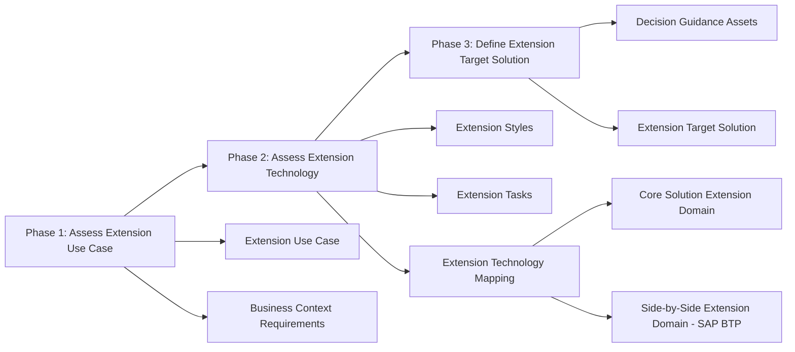

<!-- loio2a1309890001477e9470be74c2fb11f8 -->

# Extension Architecture Guide

The Extension Architecture Guide is a decision-making framework that helps architects identify the right SAP technology building block for a given extension scenario. It is based on the SAP Application Extension Methodology and forms part of the SAP BTP Guidance Framework.

<a name="loio2a1309890001477e9470be74c2fb11f8__section_what_is_eag"/>

## What Is the Extension Architecture Guide?

The Extension Architecture Guide guides enterprise architects through a three-phase process to assess, map, and define extension solutions on SAP BTP. It is particularly focused on the presentation tier — helping architects decide which technology to use when building or extending user interfaces and applications.

For the full guide, see [Extension Architecture Guide](https://help.sap.com/docs/EXTENSION_ARCHITECTURE_GUIDE/0d65087f886b45488953c28f0ad29c05/840faf790bae41d28fa4a994f80a65e4.html?locale=en-US&state=PRODUCTION&version=CLOUD) on SAP Help Portal.

The guide is based on concepts and terminology from the [SAP Application Extension Methodology](https://help.sap.com/docs/SAP_APPLICATION_EXTENSION_METHODOLOGY/2f804cb5e53d4279879009100a2b2082/cd963582f46d421c9abfd28dc25ea7e3.html?locale=en-US&state=PRODUCTION&version=CLOUD).

<a name="loio2a1309890001477e9470be74c2fb11f8__section_three_phase_process"/>

## Three-Phase Process

The Extension Architecture Guide follows a structured three-phase cycle.

**Extension Architecture Guide Phases**

<table>
<tr>
<th valign="top">

Phase

</th>
<th valign="top">

Name

</th>
<th valign="top">

Key Activities

</th>
<th valign="top">

Outputs

</th>
</tr>
<tr>
<td valign="top">

Phase 1

</td>
<td valign="top">

Assess Extension Use Case

</td>
<td valign="top">

Define the system context, business and context requirements, and application extension use case

</td>
<td valign="top">

Documented extension use case with business context

</td>
</tr>
<tr>
<td valign="top">

Phase 2

</td>
<td valign="top">

Assess Extension Technology

</td>
<td valign="top">

Identify extension styles, define extension tasks, and map extension tasks to technical extension building blocks

</td>
<td valign="top">

Extension Technology Mapping

</td>
</tr>
<tr>
<td valign="top">

Phase 3

</td>
<td valign="top">

Define Extension Target Solution

</td>
<td valign="top">

Apply decision guidance assets per extension task, assign color codes for recommendations, define the extension target solution

</td>
<td valign="top">

Extension Target Solution definition with technology mapping per task

</td>
</tr>
</table>

<a name="loio2a1309890001477e9470be74c2fb11f8__section_phase1"/>

## Phase 1: Assess Extension Use Case

In Phase 1, the architect establishes the context for the extension project. Three inputs drive this phase:

- **System Context** — the SAP system landscape, including the systems to be extended (for example, SAP S/4HANA Cloud, SAP SuccessFactors)
- **Business and Context Requirements** — the business drivers, constraints, and functional needs that the extension must satisfy
- **Application Extension Use Case** — the specific extension scenario being addressed (for example, creating a custom UI, adding a new approval workflow, or extending a business object)

<a name="loio2a1309890001477e9470be74c2fb11f8__section_phase2"/>

## Phase 2: Assess Extension Technology

Phase 2 maps extension use cases to technical building blocks through three steps.

**Extension Styles** categorize the type of extension:

- In-app (classic or key-user extensibility within the SAP application)
- Side-by-side (extensions built on SAP BTP, running alongside the SAP application)

**Extension Tasks** define the technical scope:

- Create custom UI
- Automate process
- Extend data model
- Build side-by-side app

**Extension Technology Mapping** establishes the relationship between extension tasks and technical building blocks, organized by extension domain:

- **Core Solution Extension Domain** — in-app extensibility options such as Classic Extensibility (Dynpro, WebDynpro ABAP), SAPUI5, and SAP Fiori Elements
- **Side-by-Side Extension Domain** — SAP BTP-based options such as SAP Build Apps and SAP Mobile Services

<a name="loio2a1309890001477e9470be74c2fb11f8__section_phase3"/>

## Phase 3: Define Extension Target Solution

Phase 3 applies decision guidance to each extension task identified in Phase 2 and produces the extension target solution. This phase uses:

- **Extension Technology Per Extension Task** — the specific technical building block selected for each task
- **Decision Guidance Assets** — guidance documents, evaluations, and color-coded recommendations that indicate fit, feasibility, and SAP recommendation level
- **Extension Target Solution** — the final architecture decision, documenting which technology is used for each extension task and the rationale

**Extension Technology Mapping Template**

<table>
<tr>
<th valign="top">

ID

</th>
<th valign="top">

Extension Style

</th>
<th valign="top">

Extension Task

</th>
<th valign="top">

Technical Extension Building Block

</th>
<th valign="top">

Color Code

</th>
</tr>
<tr>
<td valign="top">

P02

</td>
<td valign="top">

New User Interface

</td>
<td valign="top">

Create Custom UI

</td>
<td valign="top">

Classic Extensibility: Dynpro / WebDynpro ABAP / SAPUI5 / SAP Fiori Elements / SAP Mobile Services / SAP Build Apps

</td>
<td valign="top">

To be filled out by project team

</td>
</tr>
</table>

> ### Tip:  
> Color codes represent the recommendation level for each building block in your specific context. They must be evaluated and assigned by the project team based on the decision guidance assets and the specific system landscape.

<a name="loio2a1309890001477e9470be74c2fb11f8__section_architecture"/>

## Architecture

The diagram below shows the end-to-end flow of the Extension Architecture Guide process.

> ### Note:  
> The diagram above is a Mermaid representation for reference. For SAP Help Portal publishing, replace this code block with an exported PNG image in the `images/` folder: ``

**Related Information**  

[SAP BTP Guidance Framework Overview](overview-79bdeb2.md)

[SAP BTP Reference Architectures](reference-architectures-3de5892.md)

[Extension Architecture Guide on SAP Help Portal](https://help.sap.com/docs/EXTENSION_ARCHITECTURE_GUIDE/0d65087f886b45488953c28f0ad29c05/840faf790bae41d28fa4a994f80a65e4.html?locale=en-US&state=PRODUCTION&version=CLOUD)

[SAP Application Extension Methodology](https://help.sap.com/docs/SAP_APPLICATION_EXTENSION_METHODOLOGY/2f804cb5e53d4279879009100a2b2082/cd963582f46d421c9abfd28dc25ea7e3.html?locale=en-US&state=PRODUCTION&version=CLOUD)
