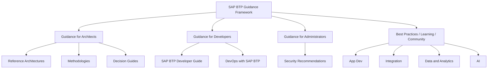

<!-- loio79bdeb211125482b966dafca814869da -->

# SAP BTP Guidance Framework Overview

The SAP BTP Guidance Framework is a central access point for architects, developers, and administrators to design, implement, and operate enterprise-grade solutions on SAP Business Technology Platform (SAP BTP). It consolidates decision guides, reference architectures, methodologies, and best practices into a single compass for BTP adoption.

> ### Note:  
> The SAP BTP Guidance Framework has moved to the [SAP Discovery Center](https://discovery-center.cloud.sap/guidance-framework). Future updates will be published there. Update your bookmarks accordingly.

<a name="loio79bdeb211125482b966dafca814869da__section_what_is_it"/>

## What Is the SAP BTP Guidance Framework?

The SAP BTP Guidance Framework provides structured guidance across three audiences — architects, developers, and administrators — and spans five domain areas: App Dev, Automation, Integration, Data and Analytics, and Artificial Intelligence (AI).

It serves as your starting point for:

- Selecting the right architecture pattern for your SAP BTP solution
- Navigating extension, integration, and data advisory methodologies
- Applying DevOps principles and security recommendations
- Finding learning resources, best practices, and community support

For the authoritative product documentation, see [SAP BTP Guidance Framework](https://help.sap.com/docs/sap_btp_guidance_framework/97dc5926388343be94efd10ae3db716c/825f4fd3d3524dd19c388fa033727692.html?locale=en-US&state=PRODUCTION&version=Cloud).

<a name="loio79bdeb211125482b966dafca814869da__section_guidance_pillars"/>

## Guidance Pillars

The framework is structured around three guidance pillars, each serving a distinct audience.

**Guidance Pillars by Audience**

<table>
<tr>
<th valign="top">

Pillar

</th>
<th valign="top">

Primary Audience

</th>
<th valign="top">

Key Deliverables

</th>
</tr>
<tr>
<td valign="top">

Guidance for Architects

</td>
<td valign="top">

Enterprise Architects, Solution Architects

</td>
<td valign="top">

Integration Architecture Guide, Extension Architecture Guide, Reference Architectures, Business Process Blueprints, Methodologies

</td>
</tr>
<tr>
<td valign="top">

Guidance for Developers

</td>
<td valign="top">

Application Developers, BTP Developers

</td>
<td valign="top">

SAP BTP Developer's Guide, Decision Guides, DevOps with SAP BTP

</td>
</tr>
<tr>
<td valign="top">

Guidance for Administrators

</td>
<td valign="top">

BTP Administrators, Platform Operators

</td>
<td valign="top">

Security Recommendations, Recommendations, DevOps Principles

</td>
</tr>
</table>

<a name="loio79bdeb211125482b966dafca814869da__section_domain_coverage"/>

## Domain Coverage

The framework spans five BTP domains, ensuring coverage across the full enterprise solution landscape.

**BTP Domain Areas**

<table>
<tr>
<th valign="top">

Domain

</th>
<th valign="top">

Description

</th>
</tr>
<tr>
<td valign="top">

App Dev

</td>
<td valign="top">

Application development on SAP BTP using CAP, SAP Build Apps, SAPUI5, and SAP Fiori Elements

</td>
</tr>
<tr>
<td valign="top">

Automation

</td>
<td valign="top">

Process automation using SAP Build Process Automation

</td>
</tr>
<tr>
<td valign="top">

Integration

</td>
<td valign="top">

Integration patterns using SAP Integration Suite and the SAP Integration Solution Advisory Methodology

</td>
</tr>
<tr>
<td valign="top">

Data and Analytics

</td>
<td valign="top">

Data architecture and analytics solutions on SAP BTP using SAP Datasphere and SAP Analytics Cloud

</td>
</tr>
<tr>
<td valign="top">

Artificial Intelligence (AI)

</td>
<td valign="top">

AI capabilities on SAP BTP including SAP AI Core, SAP AI Launchpad, and generative AI use cases

</td>
</tr>
</table>

<a name="loio79bdeb211125482b966dafca814869da__section_architecture"/>

## Framework Architecture

The SAP BTP Guidance Framework connects structured guidance assets to the underlying BTP services, acting as a navigation layer between business requirements and technical implementation.

**System Components**

<table>
<tr>
<th valign="top">

Component

</th>
<th valign="top">

Role

</th>
<th valign="top">

Technology

</th>
</tr>
<tr>
<td valign="top">

Decision Guides

</td>
<td valign="top">

Help architects and developers select the right BTP technology for a given scenario

</td>
<td valign="top">

SAP Discovery Center, SAP Help Portal

</td>
</tr>
<tr>
<td valign="top">

Reference Architectures

</td>
<td valign="top">

Curated solution templates for designing solution architectures on SAP BTP

</td>
<td valign="top">

SAP Discovery Center, draw.io, SAP LeanIX

</td>
</tr>
<tr>
<td valign="top">

Methodologies

</td>
<td valign="top">

Structured, technology-agnostic approaches to domain-specific strategies

</td>
<td valign="top">

SAP Integration Solution Advisory Methodology, SAP Application Extension Methodology, SAP Data and Analytics Advisory Methodology

</td>
</tr>
<tr>
<td valign="top">

DevOps Principles

</td>
<td valign="top">

Guidance for continuous integration and delivery on SAP BTP

</td>
<td valign="top">

SAP BTP CI/CD Service, SAP Transport Management

</td>
</tr>
<tr>
<td valign="top">

Community and Enablement

</td>
<td valign="top">

Best practices, learning journeys, and community forums

</td>
<td valign="top">

SAP Learning, SAP Community

</td>
</tr>
</table>

> ### Note:  
> The diagram above is a Mermaid representation for reference. For SAP Help Portal publishing, replace this code block with an exported PNG image in the `images/` folder: ``

<a name="loio79bdeb211125482b966dafca814869da__section_methodologies"/>

## Methodologies

The SAP BTP Guidance Framework includes three structured methodologies that provide technology-agnostic approaches for domain-specific strategies.

**Supported Methodologies**

<table>
<tr>
<th valign="top">

Methodology

</th>
<th valign="top">

Purpose

</th>
<th valign="top">

SAP Help Portal Link

</th>
</tr>
<tr>
<td valign="top">

SAP Integration Solution Advisory Methodology

</td>
<td valign="top">

Guides architects to define integration strategies and create architecture blueprints

</td>
<td valign="top">

[SAP Integration Solution Advisory Methodology](https://help.sap.com/docs/SAP_INTEGRATION_SOLUTION_ADVISORY_METHODOLOGY/f64ada51d9f44c83a751b96f955aad5a/c6bac952bb464f97b6cece3eec9cfd5f.html?locale=en-US&state=PRODUCTION&version=CLOUD)

</td>
</tr>
<tr>
<td valign="top">

SAP Application Extension Methodology

</td>
<td valign="top">

Supports enterprise architects in assessing extension use cases and defining an extension target solution

</td>
<td valign="top">

[SAP Application Extension Methodology](https://help.sap.com/docs/SAP_APPLICATION_EXTENSION_METHODOLOGY/2f804cb5e53d4279879009100a2b2082/cd963582f46d421c9abfd28dc25ea7e3.html?locale=en-US&state=PRODUCTION&version=CLOUD)

</td>
</tr>
<tr>
<td valign="top">

SAP Data and Analytics Advisory Methodology

</td>
<td valign="top">

Guides architects to define data and analytics strategies aligned with SAP BTP services

</td>
<td valign="top">

SAP Help Portal (see SAP Data Methodology)

</td>
</tr>
</table>

**Related Information**  

[SAP BTP Reference Architectures](reference-architectures-3de5892.md)

[Extension Architecture Guide](extension-architecture-guide-2a13098.md)

[SAP BTP Administrator's Guide](https://help.sap.com/docs/BTP/df50977d8bfa4c9a8a063ddb37113c43/9f2bb927464e4d1ba3d13b2d79ca9bd1.html?locale=en-US&state=PRODUCTION&version=Cloud)

[SAP BTP Guidance Framework on SAP Help Portal](https://help.sap.com/docs/sap_btp_guidance_framework/97dc5926388343be94efd10ae3db716c/825f4fd3d3524dd19c388fa033727692.html?locale=en-US&state=PRODUCTION&version=Cloud)
