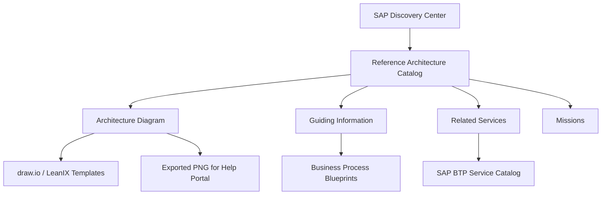

<!-- loio3de5892da01c49148fac0ee0c291ebdc -->

# SAP BTP Reference Architectures

SAP BTP reference architectures are curated solution templates that show how to design solution architectures on SAP BTP. They are hosted on SAP Discovery Center and provide an architecture diagram, guiding information, and links to related services and missions.

<a name="loio3de5892da01c49148fac0ee0c291ebdc__section_what_are_ref_archs"/>

## What Are SAP BTP Reference Architectures?

An SAP BTP reference architecture provides a proven starting point for solution design. Each reference architecture consists of three elements:

- **Architecture Diagram** — a visual representation of the solution components and their interactions
- **Guiding Information** — contextual descriptions of the components, design decisions, and applicable scenarios
- **Related Services and Missions** — links to the SAP BTP services used in the architecture and step-by-step missions on SAP Discovery Center

Reference architectures are available on SAP Discovery Center and can be accessed as part of the [SAP BTP Guidance Framework](https://help.sap.com/docs/sap_btp_guidance_framework/97dc5926388343be94efd10ae3db716c/825f4fd3d3524dd19c388fa033727692.html?locale=en-US&state=PRODUCTION&version=Cloud).

> ### Note:  
> SAP BTP reference architectures are also available as templates in SAP LeanIX. See [Using SAP BTP Reference Architecture Templates](https://help.sap.com/docs/LEANIX/72d375467c1e4dcb872dfa2998b6328d/275c4c2b7a441014971eee47cecc9754.html?locale=en-US&state=PRODUCTION&version=CLOUD) for details on how to use them in enterprise architecture diagrams.

<a name="loio3de5892da01c49148fac0ee0c291ebdc__section_ref_arch_components"/>

## Reference Architecture Components

Each SAP BTP reference architecture is structured as follows.

**SAP BTP Reference Architecture Structure**

<table>
<tr>
<th valign="top">

Element

</th>
<th valign="top">

Description

</th>
<th valign="top">

Format

</th>
</tr>
<tr>
<td valign="top">

Architecture Diagram

</td>
<td valign="top">

Visual representation of the solution using SAP BTP Solution Diagram Design Guidelines

</td>
<td valign="top">

draw.io, PNG, or SAP LeanIX diagram

</td>
</tr>
<tr>
<td valign="top">

Guiding Information

</td>
<td valign="top">

Context and design rationale that explains component responsibilities and architectural decisions

</td>
<td valign="top">

Structured text on SAP Discovery Center

</td>
</tr>
<tr>
<td valign="top">

Related Services

</td>
<td valign="top">

SAP BTP service catalog links relevant to the architecture

</td>
<td valign="top">

SAP BTP Service Catalog links

</td>
</tr>
<tr>
<td valign="top">

Missions

</td>
<td valign="top">

Step-by-step implementation guides on SAP Discovery Center

</td>
<td valign="top">

SAP Discovery Center Missions

</td>
</tr>
</table>

<a name="loio3de5892da01c49148fac0ee0c291ebdc__section_solution_diagram_design"/>

## SAP BTP Solution Diagram Design Guideline

SAP provides a set of design guidelines and a solution diagram repository to standardize how SAP BTP architectures are visualized. The BTP Solution Diagram Design Guideline defines:

- Standard icons and shapes for SAP BTP services
- Layout rules for representing multi-tier architectures
- Notation standards for cloud, on-premise, and hybrid deployments

These guidelines ensure consistent and interoperable architecture documentation across SAP projects. You can download and customize SAP BTP reference architecture solution diagrams using tools such as draw.io.

For guidance on creating architecture blueprints using reference architectures, see [Create Your Architecture Blueprints](https://help.sap.com/docs/SAP_INTEGRATION_SOLUTION_ADVISORY_METHODOLOGY/f64ada51d9f44c83a751b96f955aad5a/c6bac952bb464f97b6cece3eec9cfd5f.html?locale=en-US&state=PRODUCTION&version=CLOUD).

<a name="loio3de5892da01c49148fac0ee0c291ebdc__section_architecture_diagram"/>

## Architecture

The diagram below shows how SAP BTP reference architectures relate to the broader guidance ecosystem.

> ### Note:  
> The diagram above is a Mermaid representation for reference. For SAP Help Portal publishing, replace this code block with an exported PNG image in the `images/` folder: ``

<a name="loio3de5892da01c49148fac0ee0c291ebdc__section_using_ref_archs"/>

## Using Reference Architectures in Practice

To use an SAP BTP reference architecture in your project:

1. Browse the reference architecture catalog on SAP Discovery Center.
2. Select a reference architecture that matches your scenario (for example, integration, extension, or data architecture).
3. Review the architecture diagram and guiding information.
4. Download the diagram template (draw.io or SAP LeanIX) and customize it for your landscape.
5. Follow the linked missions to implement the architecture on SAP BTP.

Reference architectures for SAP BTP are also integrated into the [SAP Data Methodology](https://help.sap.com/docs/SAP_DATA_METHODOLOGY/a87bb2600925461190e14920a69bff7e/3c4ae50e15cf41c7a2e0c8086a97438d.html?locale=en-US&state=PRODUCTION&version=CLOUD) workflow as architecture options for data and analytics use cases.

**Related Information**  

[SAP BTP Guidance Framework Overview](overview-79bdeb2.md)

[Extension Architecture Guide](extension-architecture-guide-2a13098.md)

[Using SAP BTP Reference Architecture Templates in SAP LeanIX](https://help.sap.com/docs/LEANIX/72d375467c1e4dcb872dfa2998b6328d/275c4c2b7a441014971eee47cecc9754.html?locale=en-US&state=PRODUCTION&version=CLOUD)

[SAP BTP Guidance Framework](https://help.sap.com/docs/sap_btp_guidance_framework/97dc5926388343be94efd10ae3db716c/825f4fd3d3524dd19c388fa033727692.html?locale=en-US&state=PRODUCTION&version=Cloud)
